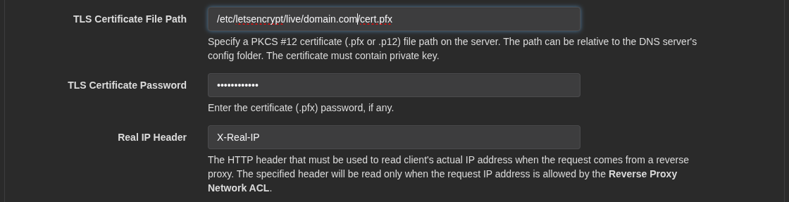
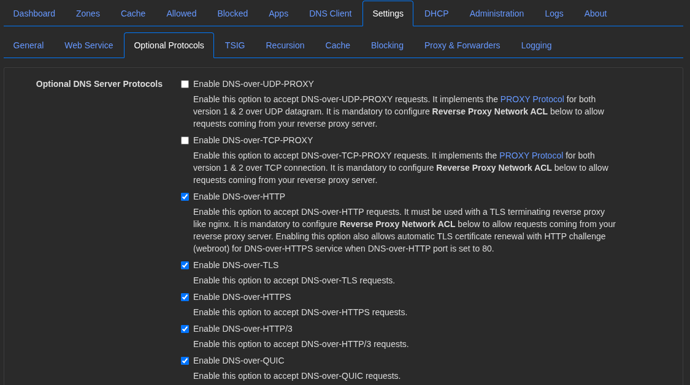
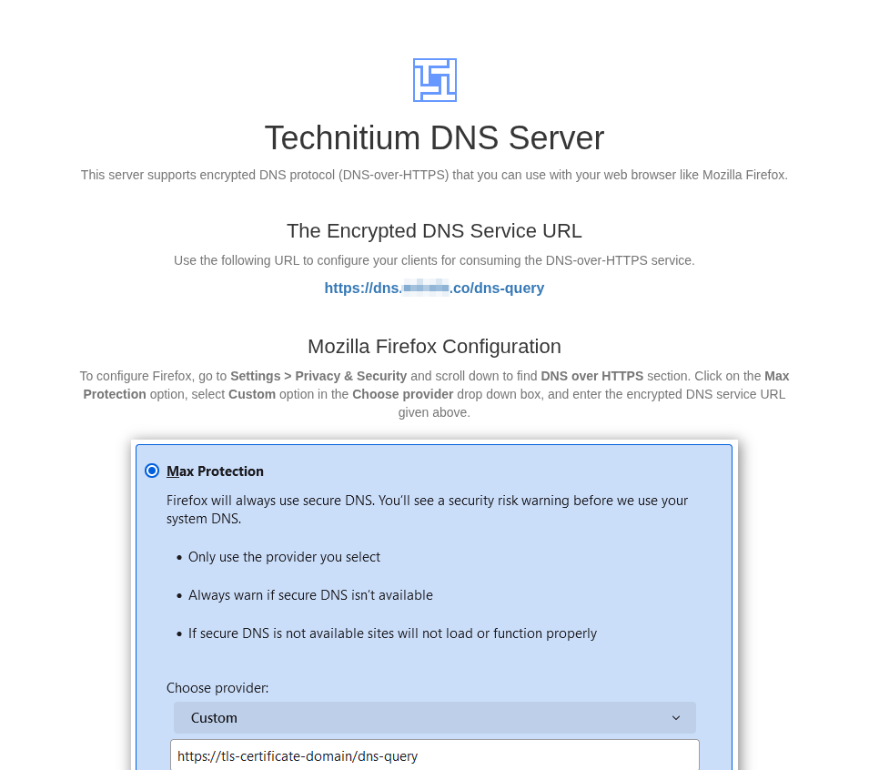

# Technitium Let's Encrypt with Cloudflare

This is how I use Let's Encrypt to serve encrypted DNS from Technitium. Certbot completes the DNS-01 challenge against Cloudflare. A deploy hook converts the issued certificate to the PKCS#12 file Technitium expects.

## Prerequisites

- A working native Technitium DNS Server installation on Debian 13 with a systemd service named `technitium`. This example assumes the service runs as root. Check with `systemctl cat technitium`. If yours runs as a dedicated user, give only that user or service group read access to the PFX and traversal access to its parent directory.
- A Cloudflare-managed public DNS zone. Create a token with `Zone:DNS:Edit` limited to that zone. The challenge does not require opening port 80.
- Clients must be able to resolve and reach your endpoint, such as `dns.domain.com`. For a direct Technitium endpoint, use a DNS-only Cloudflare record when using Cloudflare for that hostname. Decide who should be able to use recursion before exposing any listeners.

## Install required packages

Run the setup commands in a root shell.

```bash
apt install certbot python3-certbot-dns-cloudflare openssl bind9-dnsutils
```

## Configure Certbot

Store the Cloudflare token in a root-only file.

```bash
install -d -m 0700 /etc/letsencrypt/secrets
(umask 077; editor /etc/letsencrypt/secrets/cloudflare.ini)
chmod 0600 /etc/letsencrypt/secrets/cloudflare.ini
```

Set this in `cloudflare.ini`.

```ini
dns_cloudflare_api_token = YOUR_API_TOKEN
```

Save a PFX password on the first line of `/etc/letsencrypt/secrets/technitium-pfx-password` and set the file to mode `0600`. You'll use the same password in the Technitium UI.

Save this script as `/etc/letsencrypt/renewal-hooks/deploy/pkcs12convert.sh`. Replace `domain.com` here and in the request below with the same certificate name. The hook ignores other certificate lineages, writes the new PFX beside the old one, and restarts DNS only after the replacement succeeds. The restart briefly interrupts resolution.

```sh
#!/bin/sh
set -eu

lineage=/etc/letsencrypt/live/domain.com
[ "${RENEWED_LINEAGE:-}" = "$lineage" ] || exit 0

umask 077
pfx=$(mktemp /etc/dns/.letsencrypt.pfx.XXXXXX)
trap 'rm -f "$pfx"' EXIT
openssl pkcs12 -export -out "$pfx" \
  -inkey "$lineage/privkey.pem" \
  -in "$lineage/cert.pem" \
  -certfile "$lineage/chain.pem" \
  -passout file:/etc/letsencrypt/secrets/technitium-pfx-password
mv -f "$pfx" /etc/dns/letsencrypt.pfx
systemctl restart technitium
```

Use the directory from your installation if it differs from `/etc/dns`. Make the script executable with `chmod 0700 /etc/letsencrypt/renewal-hooks/deploy/pkcs12convert.sh`.

## Request cert

Replace the example domain and email address. Quote the wildcard so the shell can't expand it. If you only need one endpoint, request just that hostname and keep `--cert-name` and the hook in sync.

```bash
certbot certonly --dns-cloudflare \
  --dns-cloudflare-credentials /etc/letsencrypt/secrets/cloudflare.ini \
  --cert-name domain.com \
  -d domain.com -d '*.domain.com' \
  --agree-tos --email user@domain.com --non-interactive
```

Check that `/etc/dns/letsencrypt.pfx` exists. If your Certbot version didn't run the directory hook on initial issuance, run it once after confirming the lineage with `certbot certificates`.

```bash
RENEWED_LINEAGE=/etc/letsencrypt/live/domain.com \
  /etc/letsencrypt/renewal-hooks/deploy/pkcs12convert.sh
```

## Configure Technitium

Go to **Settings → Optional Protocols**, set **TLS Certificate File Path** to `/etc/dns/letsencrypt.pfx`, and enter the PFX password in **TLS Certificate Password**. The screenshots show my original setup. Use the file path from the script above.



Enable the protocols you'll use and save. Direct DoH uses TCP 443, DoT uses TCP 853, and DoQ uses UDP 853 on their default ports. DNS-over-HTTPS/3 adds UDP 443. Leave plaintext DNS-over-HTTP off for a direct setup. It is useful behind a TLS-terminating reverse proxy with a restricted backend.



<a id="test-new-configuration" />

## Verification

Browse to `https://dns.domain.com/dns-query`. Technitium's DoH information page showed the secure DNS URL in my setup. The browser should accept the certificate for the endpoint hostname.




From a client, query a name you expect to resolve. Include `+tls-ca` so BIND's `dig` checks the certificate. Look for `NOERROR`, the expected answer, and the server endpoint over TLS or HTTPS.

```bash
dig @dns.domain.com +tls +tls-ca example.com A
dig @dns.domain.com +https +tls-ca example.com A
```

Use a DoQ-capable client to test DoQ separately if you enabled it.

## Certbot timer information

On my Debian install, `certbot.timer` scheduled `certbot renew` twice a day with a randomized delay. Check what is enabled on your host and test renewal against staging.

```bash
systemctl list-timers certbot.timer
systemctl cat certbot.timer certbot.service
certbot renew --cert-name domain.com --dry-run
```

The dry run tests renewal and leaves the deploy hook out by default. To check the conversion as well, run the hook manually against the issued live certificate during a suitable restart window. Check the endpoint again afterward.

## References

- [Technitium's encrypted DNS setup guide](https://blog.technitium.com/2020/07/how-to-host-your-own-dns-over-https-and.html)
- [Certbot Cloudflare DNS plugin and token permissions](https://certbot-dns-cloudflare.readthedocs.io/en/stable/)
- [Certbot renewal and deploy hooks](https://eff-certbot.readthedocs.io/en/stable/using.html#renewing-certificates)
- [BIND dig TLS and HTTPS options](https://bind9.readthedocs.io/en/latest/manpages.html#dig-dns-lookup-utility)
